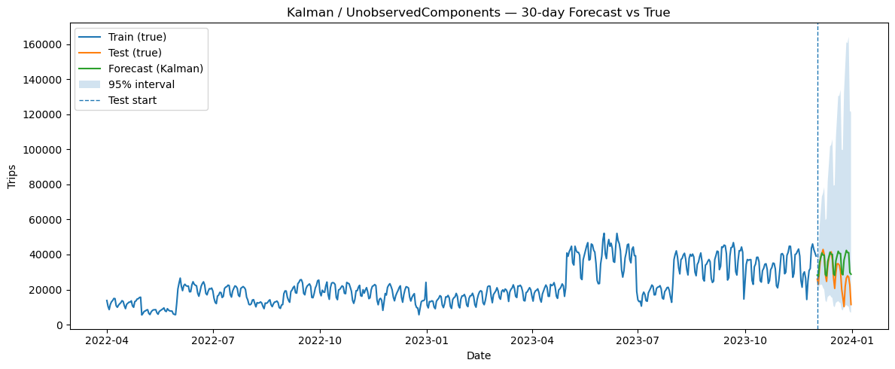
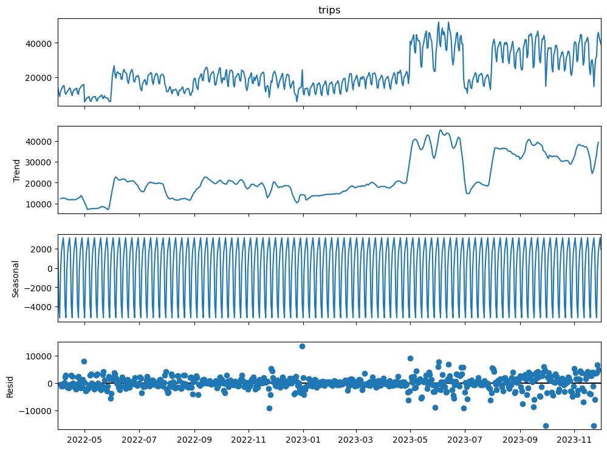

# Forecasting Daily Taxi Demand in Chicago

Forecasting daily taxi trips in Chicago 30 days ahead with five time-series models (**SARIMA**, a **Kalman filter** / unobserved-components model, a **Hidden Markov Model**, **SARIMAX with snowfall** and a **transfer-function model** with lagged snowfall), all evaluated on the same holdout month.



---

## Results

Training data: April 1, 2022 – December 1, 2023 (610 days). Test set: December 2–31, 2023.

| Model | Test MAPE |
|---|:-:|
| **Kalman filter**: local linear trend + stochastic weekly seasonal (log trips) | **35.06%** |
| SARIMAX(1,1,1)(0,1,1,7) + daily snowfall (log trips) | 38.47% |
| SARIMA(1,1,1)(0,1,1,7) | 45.19% |
| Transfer function: ARMA(1,1) + snowfall lags 0–5 (log trips) | 45.64% |
| Hidden Markov Model (3 states) on week-over-week changes + seasonal-naive baseline | 54.38% |

**Key findings**
- **Weekly seasonality dominates.** The ADF test shows that the series needs one difference, and the seasonal MA(7) term is highly significant (coefficient −0.84). In the Kalman filter, the level and seasonal components are significant but the trend is not.
- **In-sample fit is not forecasting skill.** SARIMA has a 9.93% *in-sample* MAPE but 45.19% on the holdout.
- **Snow does not explain taxi demand.** Snowfall is not significant, either same-day in the SARIMAX (p = 0.58) or at any lag from 0 to 5 days in the transfer-function model.
- **All models miss the holiday drop.** Trips fall sharply around Christmas (10,258 trips on December 25 vs. about 40,000 on a normal weekday), which motivates holiday and event regressors as the next step.



## Notebook outline

[`chicago_taxi_demand_forecasting.ipynb`](chicago_taxi_demand_forecasting.ipynb)

1. **EDA**:
   - long-run trends from 2013 to 2023, including the covid collapse;
   - restricting the data to the post-covid period;
   - removing a data anomaly (March 2022 has only about 150–200 trips per day);
   - weekly decomposition, ADF tests, ACF and PACF.
2. **SARIMA**: a manual specification and a BIC grid search over (p,d,q)(P,D,Q)₇, with residual diagnostics (Ljung-Box, Jarque-Bera).
3. **State-space models**: a Kalman filter (`UnobservedComponents`) with 95% forecast intervals, and a Gaussian HMM (`hmmlearn`).
4. **Exogenous snowfall**: SARIMAX with same-day snowfall, and a transfer-function model with snowfall lags 0–5.
5. **Model comparison** on test-set MAPE.

## Data

| File | Description | Source |
|---|---|---|
| `data/taxi_rides_chicago.csv` | Daily trips, revenue and average trip miles, 2013–2023 | Daily aggregates of the City of Chicago [Taxi Trips](https://data.cityofchicago.org/) open dataset |
| `data/chicago_snowfall_2022_2024.csv` | Daily snowfall (inches) at Chicago O'Hare (ORD), 2022–2024 | ORD daily weather summaries ([Iowa Environmental Mesonet](https://mesonet.agron.iastate.edu/)) |

## Getting started

```bash
pip install -r requirements.txt
jupyter notebook chicago_taxi_demand_forecasting.ipynb
```

## Limitations

- **A single 30-day holdout that includes the holidays.** MAPE on one unusual month is a noisy basis for comparing models. Rolling-origin cross-validation would give a more robust ranking.
- **Abrupt level shifts in 2023** (for example, the jump in May 2023 and the drop in July 2023) that no model explains. They may come from changes in reporting.
- **Transfer function specification.** It is fit on log trips without differencing, so its AR coefficient is about 1 (close to a unit root), and the MA term was estimated without enforcing invertibility.
- **No calendar regressors** (holidays, events such as Bears games or the Chicago Marathon), which are the most promising next step.

## Tech stack

Python · statsmodels (SARIMAX, UnobservedComponents, ADF, seasonal decomposition) · hmmlearn · scikit-learn · pandas · NumPy · Matplotlib

---

*Built as part of the Time Series Analysis and Forecasting course in my master's program at the University of Chicago.*
